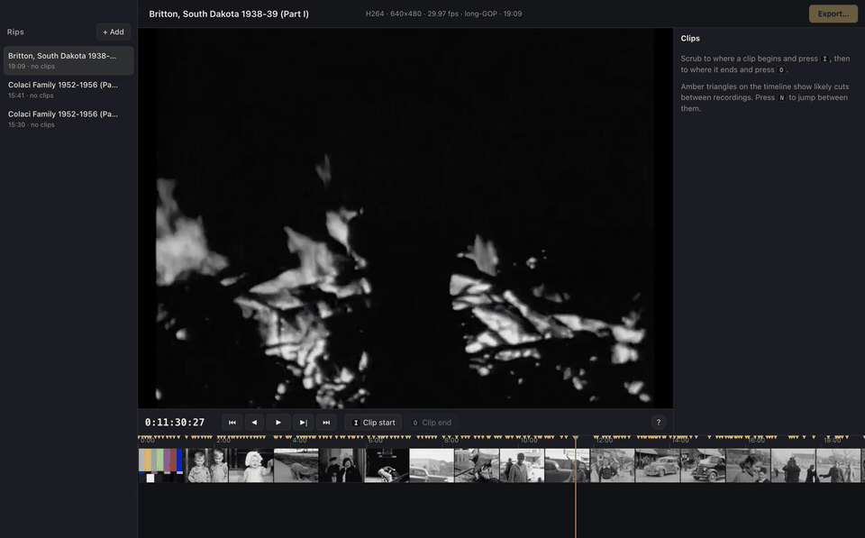
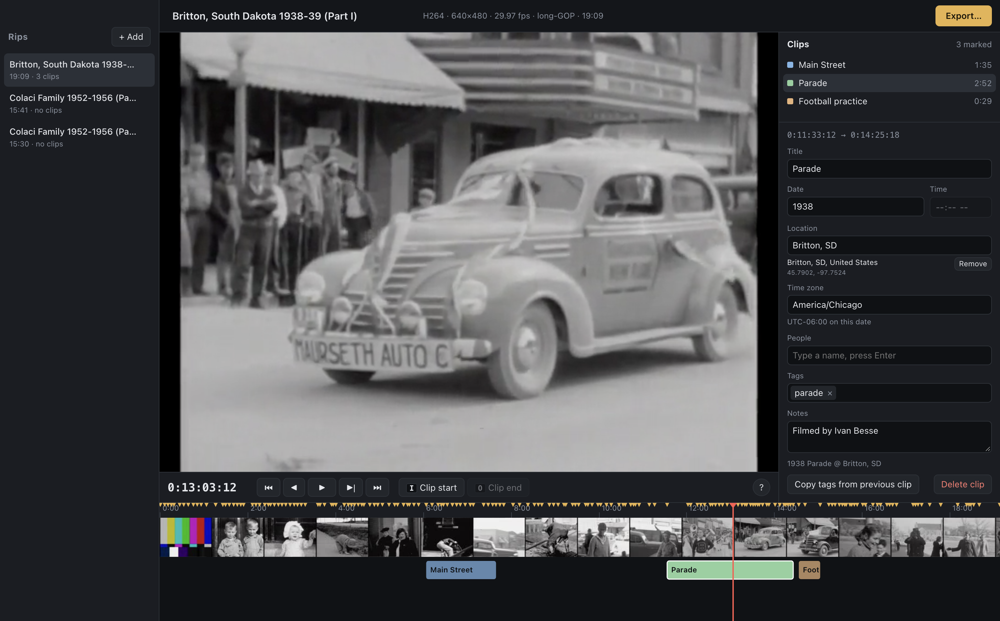
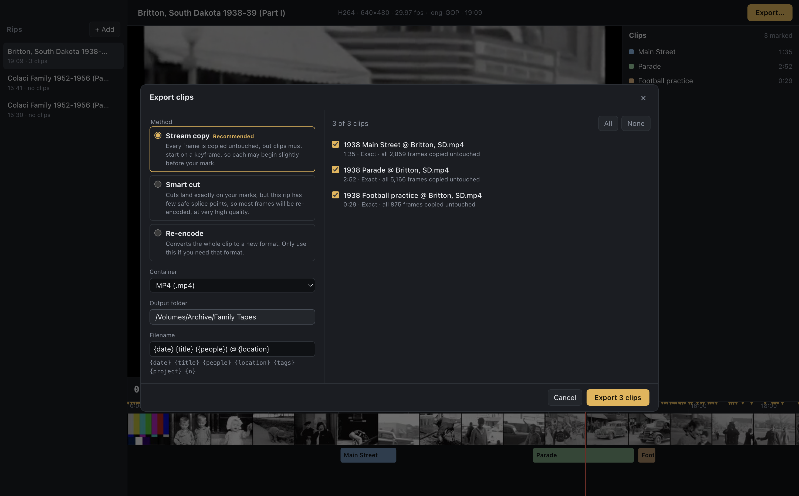
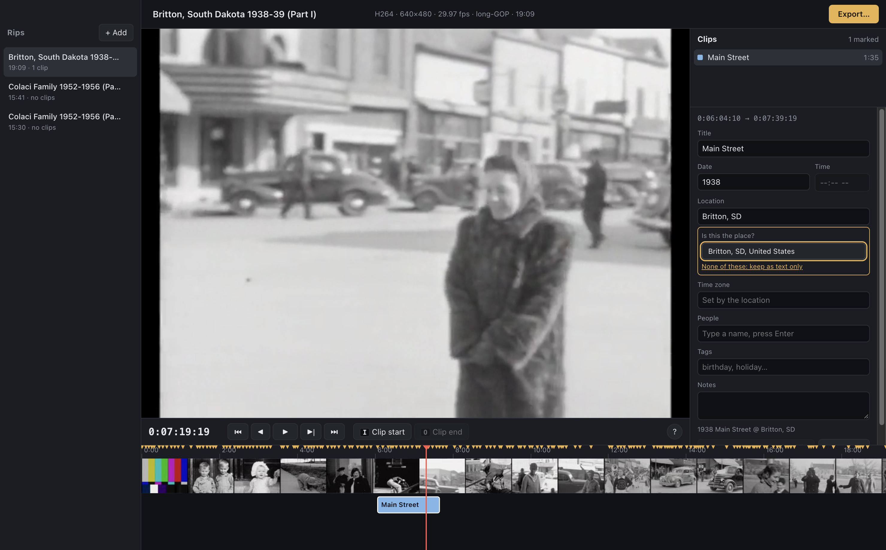

> **Note:** This README and the project itself were generated with [Claude](https://claude.ai).

# Magical Media Editor

Split long tape rips into tagged clips without losing quality. Each rip is its own
project: scrub through it, mark where clips start and end, tag them, and export.
The original file is never changed.

[](docs/demo.mp4)

*Marking three clips, tagging them, and exporting them. [Watch the full-quality video](docs/demo.mp4).*



## Running

Needs Node, pnpm, ffmpeg and exiftool (`brew install ffmpeg exiftool`), plus Xcode's
command line tools (`xcode-select --install`) for place lookups. Without exiftool or
the Xcode tools everything still works, except that location and time tags aren't
written for Apple apps, or places can't be looked up.

```sh
pnpm install
pnpm start        # build and run
pnpm dev          # run with hot reload
pnpm dist         # build the Mac app and disk image into dist/
```

The app is Apple silicon only, and still needs ffmpeg and exiftool from Homebrew. It
isn't signed with a Developer ID or notarized, so a copy built on your own Mac opens
normally, but macOS will block one downloaded from elsewhere. It shares its library
with `pnpm start`, so don't run both at once.

## Using it

1. Drop rips on the window, or use **+ Add**. Each one is indexed in the background,
   and given a preview if Chromium can't play it directly (a 2-hour tape takes about
   5 minutes on Apple silicon).
2. Scrub the timeline. Amber triangles mark likely cuts between recordings; `N` and
   `Shift+N` jump between them.
3. Press `I` where a clip starts and `O` where it ends. The frame at `O` is the first
   one *not* in the clip.
4. Press `Enter` to title the clip, and fill in date, location and people. Names and
   places you've used on any tape are offered as you type. See [Locations](#locations).
5. Press `E` to export. Press `?` at any time for all the shortcuts.

## How clips are cut

| Your rip | Default | Result |
|---|---|---|
| DV, HuffYUV, FFV1, ProRes (every frame is a keyframe) | Stream copy | Exact on your marks. Every frame untouched. |
| H.264, H.265, MPEG-2 | Smart cut | Exact on your marks. Only the frames between each mark and its nearest keyframe are re-encoded, at very high quality. Everything else is untouched. |
| Other long-GOP codecs, and open-GOP H.264 | Stream copy | Every frame untouched, but a clip may start a few frames before your mark. |

Re-encoding the whole clip (FFV1, ProRes, H.264, H.265) is available when you need a
particular format. Interlacing is always preserved; only the on-screen preview is
deinterlaced. The export dialog shows what will happen to each clip before it runs.

Audio is copied unchanged unless the container can't hold it, in which case it is
converted losslessly where possible, and the dialog says so.

MKV holds anything, but QuickTime can't open it. Choose MP4 or MOV for Apple apps.



## Locations



Type a place in your own words, like `Butternut, WI` or `Walt Disney World`, and press
Enter. The app looks it up in Apple Maps and asks you to confirm the match. Press Enter
again to accept it. After that, the name fills in by itself on every clip and tape.

Confirming matters: searches also find unrelated businesses, and `Grandma's house`
finds a shop in Oregon. Choose **keep as text only** for places like that, or type
coordinates such as `43.0731, -89.4012` to pin one yourself.

Your typed text is what goes in the filename. A confirmed place also adds coordinates,
and sets the time zone unless you've already chosen one. Looking up a place sends the
text you typed to Apple. Nothing else about your clips leaves your computer.

## Metadata

| Field | MP4 and MOV | MKV |
|---|---|---|
| Title, people, notes, tape name | Read by Apple apps | Tags |
| Location name and coordinates | QuickTime location tags, read by Apple software | `LOCATION`, `LOCATION_ISO6709` |
| Tags | QuickTime keywords | `KEYWORDS` |
| Date, time and time zone | QuickTime creation date, with the offset that applied that day | `DATE`, `TIME_ZONE` |

`creation_time` is written in every format, and the file's own dates are set to match,
because Finder and Spotlight go by those. So a clip's "Date Modified" will be the day it
was recorded.

These tags need a full moment in time, so a partial date uses its earliest day, and a
missing time uses noon, which keeps the calendar date right wherever the file is viewed.
With no time zone, your computer's is used. The `date` tag keeps exactly what you typed.
AVI and MPEG files store very little of this.

## Data

Projects, previews and thumbnails live in
`~/Library/Application Support/Magical Media Editor/library`. A preview takes about
850 MB per hour of tape. Removing a project deletes these, and never the rip or exports.

Quitting stops any background work, which picks up again next time from the start of
the step it was on. An unfinished export is discarded.

## How it works

ffmpeg's `-ss` can't be relied on for lossless cutting: it starts stream copies up to a
GOP away from the requested time, slips audio against video, and overshoots on files
with no seek index. So each rip's packets are indexed on import (`src/main/probe.ts`),
cuts are planned against that table (`src/main/cutplan.ts`), and exact packets are
selected with bitstream filters (`src/main/cutter.ts`). Comments there explain why.

## Tests

```sh
pnpm test          # cutting, proxies and filenames, verified by frame hash and A/V sync
pnpm test:e2e      # drives the real app
pnpm typecheck
```

## Demo footage

The video and screenshots use public domain films from the Prelinger Archives on the
Internet Archive: [Amateur films: Ivan Besse collection: Britton, South Dakota 1938-39
(Part I)](https://archive.org/details/sIvanBes1938_2), and Colaci Home Movies: Family
1952-1956 ([Part I](https://archive.org/details/colachi_home_movies_1),
[Part II](https://archive.org/details/colachi_home_movies_2)).
